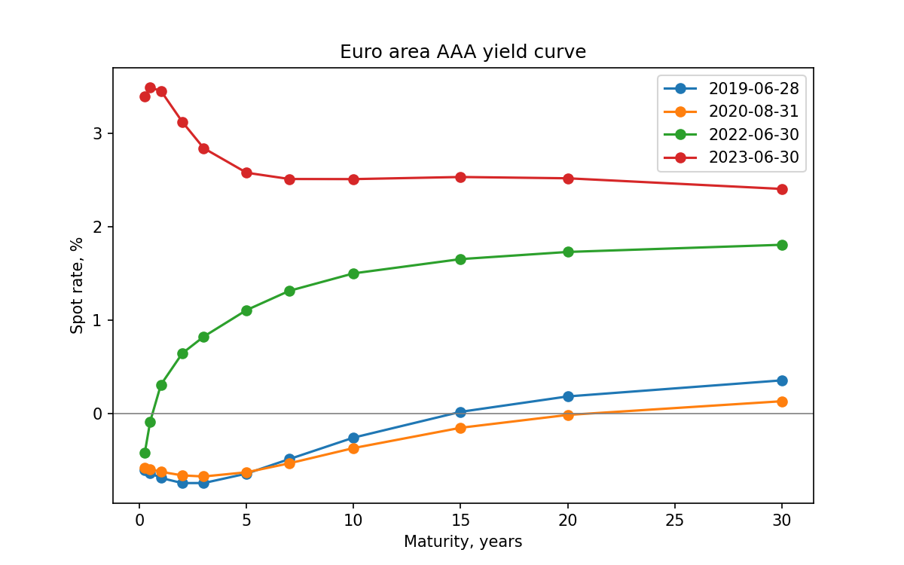
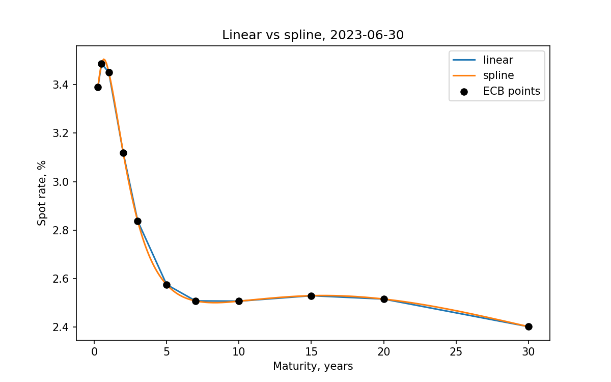
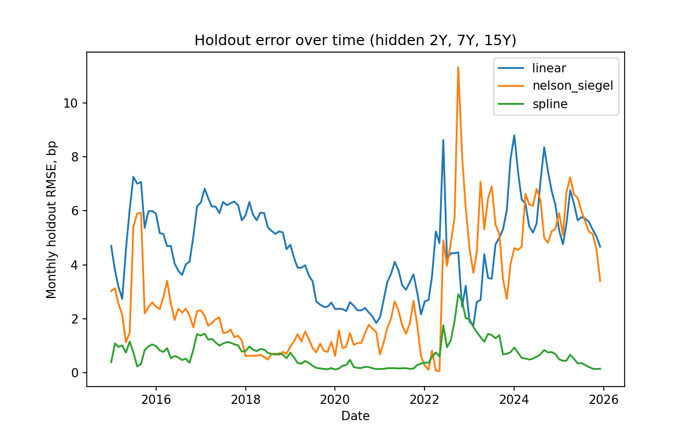
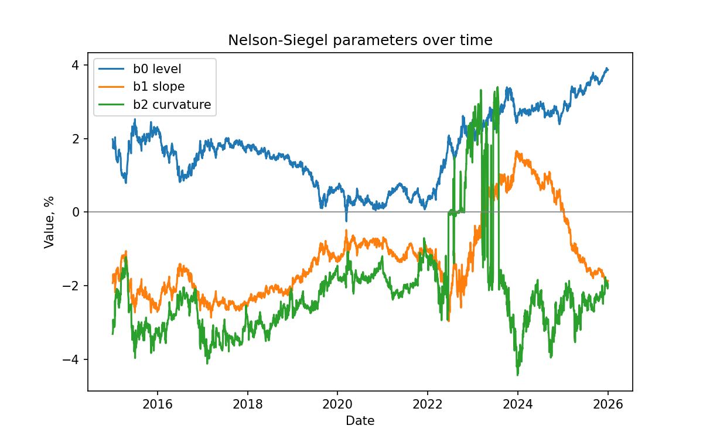

# CurveLq

Which method recovers the euro area yield curve best, and where does each one break?

A yield curve is known only at a few maturities, but banks need a rate for any maturity to price bonds and swaps. This project builds the curve with three methods, hides part of the data and measures how well each method recovers it.

## Result

Cubic spline recovers hidden maturities with an RMSE of 0.88 bp, against 3.65 bp for Nelson-Siegel and 4.94 bp for linear interpolation (2806 days, 2015-2025). Nelson-Siegel breaks from mid-2022, when rates rise fast and the curve inverts.

## Data

- Source: ECB Data Portal, dataset YC (euro area yield curves), free and without registration.
- Spot rates for AAA euro area government bonds, in percent.
- 11 maturities: 3M, 6M, 1Y, 2Y, 3Y, 5Y, 7Y, 10Y, 15Y, 20Y, 30Y.
- Daily, 2015-01-01 to 2025-12-31: 2806 days, no missing values, no daily jumps above 50 bp.



Rates are negative in 2019 and 2020, and the curve is inverted in 2023.

## Methods

| Method | Idea | Passes through the points |
|---|---|---|
| Linear | Straight lines between points, flat outside the range | Yes |
| Cubic spline | Smooth cubic pieces, natural boundary condition | Yes |
| Nelson-Siegel | Four parameters: level, slope, curvature and lambda | No, it is a best fit |

Nelson-Siegel is fitted with a grid search over lambda (0.1 to 3.0, step 0.05). For each lambda the three betas come from a linear regression.



## Holdout test

Fitting and testing on the same points says nothing: linear and spline have zero error by construction. So the 2Y, 7Y and 15Y rates are hidden, each curve is built from the other 8 maturities, and the error is measured on the hidden ones.

RMSE in bp:

| Method | All | 2Y | 7Y | 15Y |
|---|---|---|---|---|
| Cubic spline | 0.88 | 1.09 | 0.63 | 0.84 |
| Nelson-Siegel | 3.65 | 2.71 | 2.34 | 5.20 |
| Linear | 4.94 | 4.60 | 2.74 | 6.68 |

RMSE in bp by year:

| Year | Linear | Nelson-Siegel | Cubic spline |
|---|---|---|---|
| 2015 | 5.54 | 3.57 | 0.85 |
| 2016 | 4.75 | 2.41 | 0.79 |
| 2017 | 6.25 | 1.74 | 1.15 |
| 2018 | 5.55 | 0.65 | 0.78 |
| 2019 | 3.45 | 1.11 | 0.37 |
| 2020 | 2.31 | 1.30 | 0.24 |
| 2021 | 3.24 | 1.82 | 0.20 |
| 2022 | 4.53 | 5.23 | 1.59 |
| 2023 | 4.44 | 5.09 | 1.33 |
| 2024 | 6.84 | 5.61 | 0.69 |
| 2025 | 5.55 | 5.75 | 0.39 |



## Where each method breaks

- **Cubic spline** is the most accurate in every year except 2018. Its worst month is October 2022 (2.9 bp).
- **Nelson-Siegel** works well in calm years (0.65 bp in 2018) but its error stays above 5 bp in 2022-2025 and peaks at 11.3 bp in October 2022. In those years it is often worse than linear interpolation. The likely reason is that four parameters cannot describe fast rate hikes and an inverted curve. The fitted curvature and lambda jump from day to day in that period, as the chart below shows.
- **Linear interpolation** does not break at one moment. It is steadily off where the curve bends, mostly at 15Y (6.68 bp), between the 10Y and 20Y points.



## What it means for a bond price

A 3% annual coupon bond is priced from each curve on every day. The table shows the price difference against the spline, in price points (1.00 = 1% of nominal).

| Comparison | Mean | Max |
|---|---|---|
| 10Y bond, linear vs spline | 0.00 | 0.01 |
| 10Y bond, Nelson-Siegel vs spline | 0.11 | 0.90 |
| 30Y bond, linear vs spline | 0.10 | 0.20 |
| 30Y bond, Nelson-Siegel vs spline | 0.59 | 3.04 |

The choice of method moves the price of a 30Y bond by 0.59 points on average, which is 5,900 euro per million of nominal.

On the last curve (2025-12-31, spline) the same bond has this rate risk:

| Maturity | Price | DV01 | +100 bp parallel | Steepening, long end +50 bp |
|---|---|---|---|---|
| 2Y | 101.69 | 0.020 | -1.98 | 0.00 |
| 10Y | 100.50 | 0.088 | -8.41 | -4.04 |
| 30Y | 91.78 | 0.178 | -15.76 | -8.10 |

## Limitations

- The ECB data is already a smooth model curve (Svensson), not raw bond prices. This favours a smooth method like the spline. On noisy market prices the ranking could be different.
- Only three maturities are hidden, all inside the range. Extrapolation beyond 30Y is not tested.
- The lambda grid has a step of 0.05, so Nelson-Siegel is not fitted exactly.
- Bonds are priced on a coupon date with whole years to maturity, without accrued interest.
- In the bond comparison there is no true price, only the difference between methods.

## How to run

```bash
python3 -m venv .venv
source .venv/bin/activate
pip install -r requirements.txt
python -m pytest
python -m curvelab run
```

The full run takes about one minute and writes tables and charts to `outputs/`. Add `--refresh` to download the data again from the ECB.

## Project structure

| File | What it does |
|---|---|
| `curvelab/config.py` | Maturities, ECB codes, date range |
| `curvelab/data.py` | Download, cache, quality checks, cleaning |
| `curvelab/curves.py` | Linear, cubic spline and Nelson-Siegel curves |
| `curvelab/ns_params.py` | Nelson-Siegel parameters for every day |
| `curvelab/holdout.py` | Holdout test for all days and methods |
| `curvelab/summary.py` | RMSE tables |
| `curvelab/pricing.py` | Discount factors, bond price, DV01, scenarios |
| `curvelab/compare.py` | Bond price across curve methods |
| `curvelab/plots.py` | All charts |
